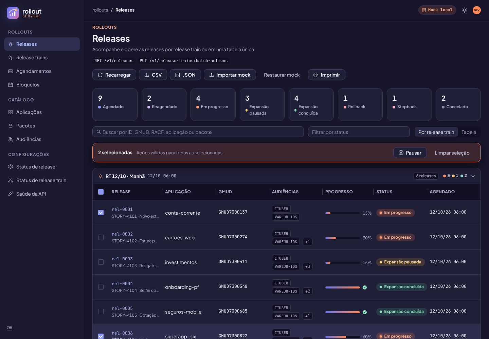
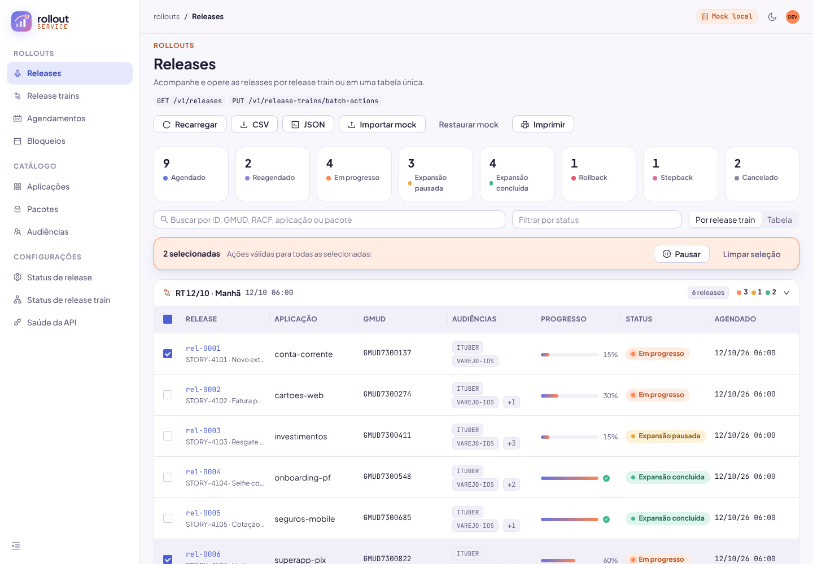
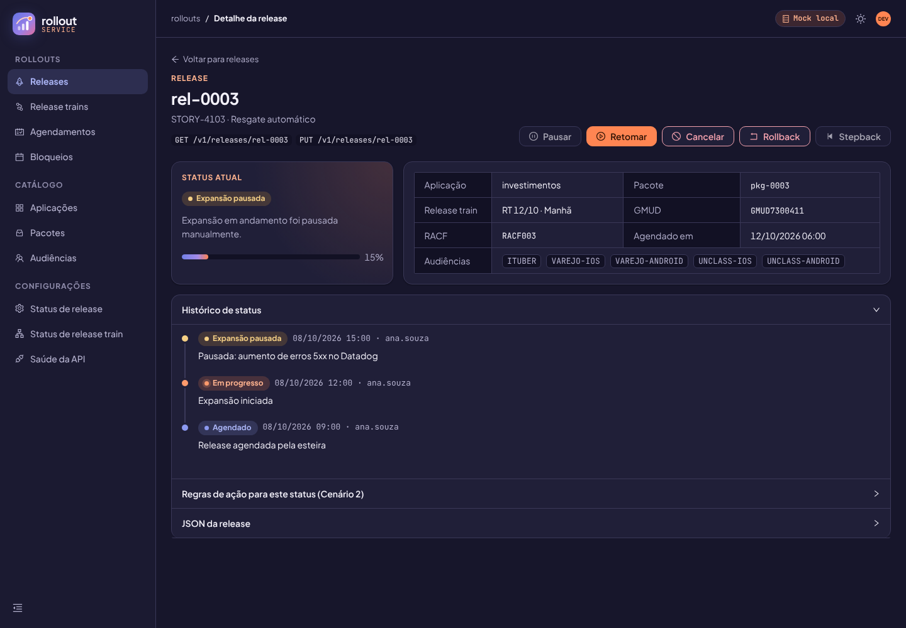
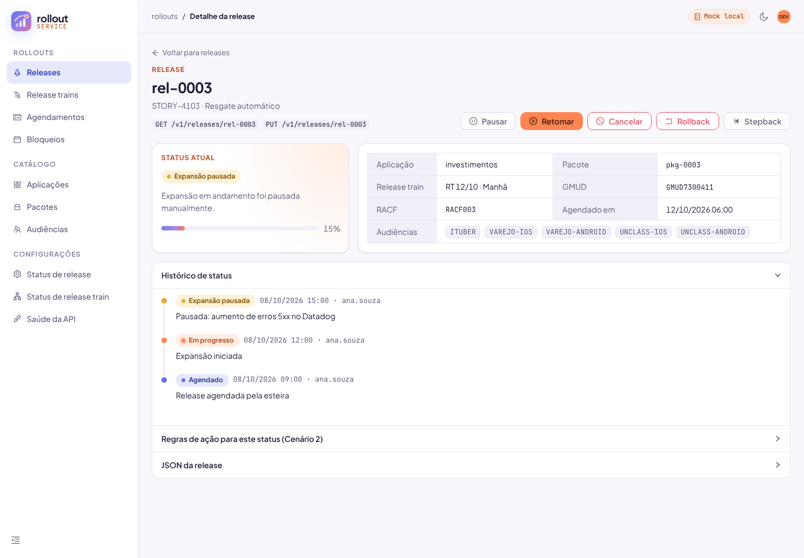

<p align="center">
  
</p>

<h1 align="center">Rollout Service · Frontend</h1>

<p align="center">
  Template Angular para operar releases e release trains: tabelas, acordeões, rotas, mock local e caminho pronto para o backend.
</p>

---

## Visão geral

O frontend do Rollout Service é uma aplicação **Angular 19** voltada para quem desenvolve e opera o rollout. Ele nasce com:

- **Página de releases** com duas visões:
  - **por release train**: acordeões, um por trem, cada um com a sua tabela;
  - **tabela única**: com paginação.
- **Detalhe da release** com ações individuais, histórico em timeline, regras de ação e o JSON bruto.
- **Todas as rotas** derivadas de `docs/proposta/endpoints`. As telas que ainda não existem já abrem mostrando os endpoints que vão consumir.
- **Dados do mock local** (`public/mocks`), com alterações guardadas no `localStorage`. Uma chave de configuração liga o backend.
- **Tema claro e escuro** em azul e laranja, com tons femininos de apoio (rosa e lilás).
- **Testes**: Jest para unidade (nunca Jasmine/Karma) e Playwright para os cenários E2E.

| Tema escuro | Tema claro |
| --- | --- |
|  |  |
|  |  |

## Documentação

| Documento | Conteúdo |
| --- | --- |
| [Tema](tema.md) | Paleta azul e laranja, tons femininos, tokens claro/escuro, logo, NG-ZORRO |
| [Rotas](rotas.md) | Mapa rota → tela → endpoints e como implementar uma tela nova |
| [Dados e integração](dados-e-integracao.md) | Mock local, `localStorage`, NgRx e como ligar o backend |
| [Testes](testes.md) | Jest e Playwright: o que existe, como rodar, como escrever |
| [Deploy](deploy.md) | Vercel e configurações |

## Stack

| Camada | Tecnologia | Por quê |
| --- | --- | --- |
| Framework | Angular 19 (standalone, signals, control flow `@if`/`@for`) | Padrão do time e do MFE `itau-wj8-app-rollout` |
| Componentes | NG-ZORRO 19 (Ant Design) | Tabela, acordeão, modal e formulário prontos e acessíveis |
| Estado | NgRx 19 (store, effects, entity, devtools) | Fluxo previsível; a tela não sabe se os dados vêm do mock ou da API |
| Estilos | SCSS + CSS custom properties | Um tema, dois modos (claro/escuro), sem duplicar CSS |
| Testes unitários | Jest + jest-preset-angular | Mais rápido que Karma, sem navegador; **nunca Jasmine** |
| Testes E2E | Playwright | Cenários reais no navegador, desktop e mobile |
| Deploy | Vercel | SPA estática com mock local |

## Como rodar

Pré-requisitos: Node 20.11 ou superior (recomendado 22) e npm 10.

```bash
cd frontend
npm install
npm start            # http://localhost:6030 — usa o mock local
```

### Scripts

| Script | O que faz |
| --- | --- |
| `npm start` | Servidor de desenvolvimento na porta 6030 |
| `npm run build` | Build de produção em `dist/frontend/browser` |
| `npm test` | Testes unitários (Jest) |
| `npm run test:watch` | Jest em modo watch |
| `npm run test:coverage` | Jest com relatório de cobertura (mínimo de 80% em linhas) |
| `npm run e2e` | Cenários Playwright (sobe o `ng serve` sozinho) |
| `npm run e2e:ui` | Playwright no modo interativo |
| `npm run e2e:report` | Abre o último relatório do Playwright |

Na primeira vez que for rodar o Playwright na máquina, instale o navegador com `npx playwright install chromium`.

## Estrutura de pastas

```text
frontend/
├── docs/                         documentação do frontend (este diretório)
├── e2e/                          cenários Playwright
├── public/
│   ├── logo.svg, favicon.svg
│   └── mocks/                    dados locais (releases.json, checks.json)
├── src/
│   ├── environments/             environment.ts (dev) e environment.prod.ts
│   ├── styles.scss               entrada global de estilos
│   └── app/
│       ├── app.config.ts         providers: router, http, NG-ZORRO, NgRx
│       ├── app.routes.ts         rotas (derivadas de docs/proposta/endpoints)
│       ├── core/
│       │   ├── config/           caminhos, endpoints, ícones, token de ambiente
│       │   ├── interceptors/     api-error.interceptor.ts
│       │   ├── models/           envelope da API, paginação, ambiente, tema, rota
│       │   └── services/
│       │       ├── storage.service.ts
│       │       ├── import-export.service.ts
│       │       ├── print-layout.service.ts
│       │       ├── theme.service.ts
│       │       ├── api.service.ts
│       │       ├── releases-data.service.ts
│       │       └── health.service.ts
│       ├── models/               domínio: release, status, ações e as regras de ação
│       ├── pages/
│       │   ├── releases/         página de releases + store NgRx (store/)
│       │   ├── release-detail/
│       │   ├── health/
│       │   ├── em-construcao/    tela padrão das rotas ainda não implementadas
│       │   └── nao-encontrada/
│       ├── shared/
│       │   ├── components/       layout (shell), logo, status-tag, theme-toggle,
│       │   │                     page-header, data-source-badge, release-action-modal
│       │   └── styles/
│       │       ├── abstracts/    _palette.scss, _mixins.scss (não geram CSS)
│       │       └── base/         _theme.scss (TEMA PRINCIPAL), _reset, _typography,
│       │                         _ng-zorro.scss, _print.scss
│       └── testing/              fixtures e providers de teste
├── jest.config.ts
├── playwright.config.ts
└── vercel.json
```

**Por que `core`, `models`, `pages` e `shared`:**

- **`core`**: o que existe uma vez só no app (serviços singleton, configuração, interceptors).
- **`models`**: o domínio puro, sem Angular. As regras de ação ficam aqui e são testadas sozinhas.
- **`pages`**: uma pasta por tela. O estado NgRx mora junto da página que é dona dele.
- **`shared`**: blocos reutilizáveis e o tema.

## Convenções

- **Componentes standalone**, `ChangeDetectionStrategy.OnPush` e signals (`input()`, `computed()`, `store.selectSignal()`).
- **Prefixo `rs-`** (rollout service) nos seletores, nas classes CSS e nos tokens (`--rs-*`).
- **`data-testid`** em todo elemento usado pelos testes E2E.
- **Cores**: nunca hex solto em componente; sempre um token do tema (ver [tema.md](tema.md)).
- **Rotas e endpoints**: nunca string solta; use `APP_PATHS` e `API_ENDPOINTS` (`core/config`).
- **Regras de negócio** (o que cada status permite) só em `models/release-action.rules.ts`.
- **Commits** em Conventional Commits, com a descrição em pt-BR (ex.: `feat(releases): adiciona filtro por trem`).

## Deploy e configurações

### Provedor / plataforma

- **Frontend:** Vercel
- **Backend:** `N/A` (app client-side)
- **Banco:** `N/A` (dados do usuário ficam no `localStorage` do navegador)

Detalhes em [deploy.md](deploy.md). Quando o backend Go for publicado, esta seção muda junto com o `dataSource` do `environment.prod.ts`.
