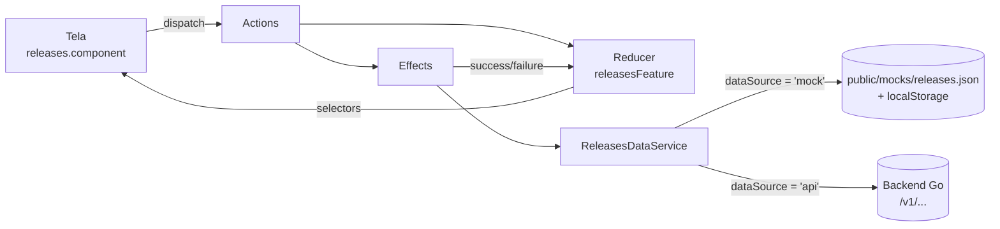

# Dados: do mock local ao backend

Hoje o frontend roda **100% no navegador**: lê os dados de `public/mocks/*.json` e grava as alterações no `localStorage`. Para ligar no backend Go basta trocar uma configuração. Nenhuma tela ou store muda.

> **Analogia:** o `ReleasesDataService` é a tomada da parede. Hoje ela está ligada num gerador (o mock local); amanhã, na rede elétrica (o backend). O aparelho, que é a tela, não percebe a troca.

## Fluxo de dados



1. A tela só **despacha ações** (`ReleasesPageActions.opened`, `filtersChanged`, `batchActionRequested`…) e **lê selectors** como signals (`store.selectSignal`).
2. Os **effects** chamam o `ReleasesDataService` e devolvem `ReleasesApiActions.*Success` ou `*Failure`.
3. O **reducer** guarda as releases com `@ngrx/entity`, além de filtros, paginação, visão e seleção.
4. Os **selectors** derivam o que a tela mostra: grupos por release train, contagem por status, ações permitidas.

## Configuração

`src/environments/environment.ts` (desenvolvimento) e `environment.prod.ts` (Vercel):

```ts
export const environment: AppEnvironment = {
  production: false,
  dataSource: 'mock',            // 'mock' | 'api'
  apiUrl: 'http://localhost:8080',
  apiPrefix: '/v1',
  mockDelayMs: 350,              // atraso artificial do mock (0 = instantâneo)
};
```

Os serviços não importam o arquivo de ambiente direto. Eles injetam `APP_ENVIRONMENT` (`core/config/environment.token.ts`), e por isso os testes trocam a fonte de dados sem mexer em arquivos.

## Modo mock

| O quê | Onde |
| --- | --- |
| Dados iniciais | `public/mocks/releases.json` (26 releases em 4 release trains + individuais, todos os 8 status) |
| Saúde da API | `public/mocks/checks.json` |
| Alterações do usuário | `localStorage` → `rollout.releases.db` |
| Filtros e paginação | Feitos no navegador (`filterReleases`, `paginate`) |
| Ações | Aplicadas por `applyReleaseAction`, com as **mesmas regras** do backend |

Na página de releases:

- **Restaurar mock** apaga o `localStorage` e volta ao JSON original.
- **Importar mock** carrega um `.json` seu, como array de releases ou no envelope `{ data: { items } }`. Serve para testar um cenário específico sem mexer no código.
- **CSV / JSON** exportam a lista atual.

O mock usa o mesmo envelope do backend (`docs/pagination.md` e `docs/INTEGRACAO-BACKEND.md`):

```json
{
  "success": true,
  "data": {
    "items": [ { "id": "rel-0001", "status": "in_progress", "...": "..." } ],
    "pagination": { "page": 1, "limit": 10, "total": 26 }
  }
}
```

## Ligando o backend

1. Suba o backend (`make docker-up` na pasta do backend) e confira `curl http://localhost:8080/v1/checks`.
2. Em `environment.ts`, troque `dataSource` para `'api'` e confira `apiUrl`.
3. Abra `/checks` no app: deve aparecer o status do backend.
4. Abra `/releases`. Agora as chamadas vão para:

| Ação na tela | Requisição |
| --- | --- |
| Abrir, filtrar, paginar | `GET /v1/releases?page=&limit=&status=&search=&releaseTrainId=` |
| Abrir o detalhe | `GET /v1/releases/:id` |
| Ação individual (detalhe) | `PUT /v1/releases/:id` com `{ action, reason, scheduledAt? }` |
| Ação em lote (release train) | `PUT /v1/release-trains/batch-actions` com `{ releaseIds, action, reason, scheduledAt? }` |

> Os corpos de `PUT` acima são a proposta do frontend. Os arquivos de `docs/proposta/endpoints` ainda estão vazios; quando o contrato for fechado, ajuste **só** o `ReleasesDataService` e o `API_ENDPOINTS`.

### Camadas HTTP

| Arquivo | Papel |
| --- | --- |
| `core/services/api.service.ts` | Monta `apiUrl + apiPrefix + path`, serializa a query (inclusive arrays) e desembrulha `{ success, data, error }` |
| `core/interceptors/api-error.interceptor.ts` | Converte qualquer erro em `ApiError { code, message }`. Erro de rede vira mensagem "verifique se o backend está rodando" |
| `core/config/api-endpoints.ts` | Todos os caminhos da API em um só lugar |

## Regras de ação

As matrizes de `docs/proposta/regras-permissionamentos/regras-acoes.md` estão codificadas em **`src/app/models/release-action.rules.ts`** e testadas linha a linha em `release-action.rules.spec.ts`.

| Cenário | Tela | Ações |
| --- | --- | --- |
| 1: Lote | Releases (acordeão por release train) | Pausar, Retomar, Cancelar, Reagendar |
| 2: Individual | Detalhe da release | Pausar, Retomar, Cancelar, Rollback, Stepback |

- Em lote, só aparecem as ações válidas para **todas** as releases selecionadas (interseção). Selecionar uma em progresso e uma agendada não deixa nenhuma ação.
- No detalhe, todos os botões aparecem. Os não permitidos ficam desabilitados, com o motivo no tooltip.
- Toda ação pede um **motivo**, que vai para o histórico de status (auditoria). Reagendar também pede a nova data.

### Mapeamento de status

O frontend usa os status da proposta em `snake_case`: `scheduled`, `rescheduled`, `in_progress`, `expansion_paused`, `expansion_completed`, `rollback`, `stepback`, `canceled`.

O plano do backend também cita nomes em maiúsculas (`WAITING`, `PAUSED`, `ROLLBACK_REQUESTED`…). Se o backend responder com outros nomes, ajuste **só** `models/release-status.model.ts` ou crie um mapeador no `ReleasesDataService`. Rótulos, cores e regras leem desse arquivo.
